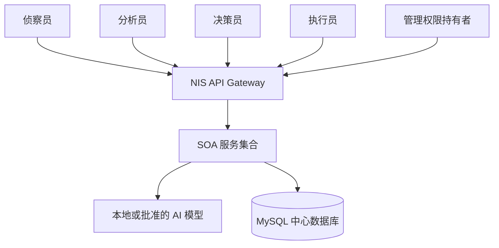
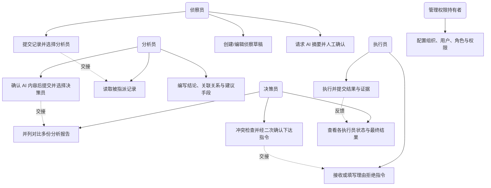
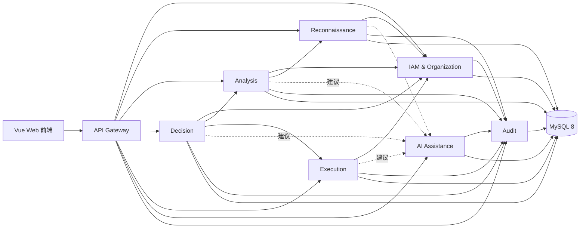
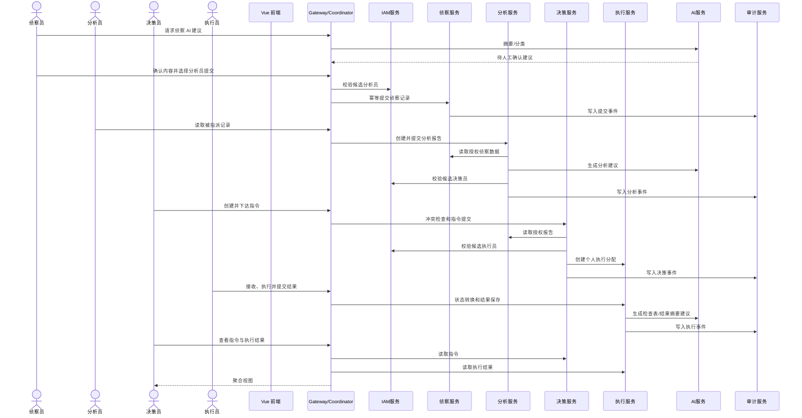
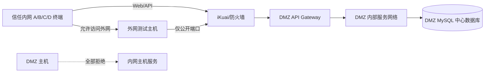

# 系统总体架构

版本：0.3（补充角色用例与多用户约束）

状态：已由 A 审核通过

## 1. 架构目标

- 使用面向服务架构（SOA）按业务能力划分可独立部署的服务。
- 通过统一服务契约支撑侦察、分析、决策、执行的完整 OODA 闭环。
- 保持用户、角色、权限、组织、多用户协同、AI 人在回路和全过程审计要求不变。
- 支持四台终端同时使用以及外网、DMZ、信任内网隔离验证。
- 控制四人课程项目的实现复杂度，不把消息队列、服务注册中心和分布式事务设为基础验收依赖。

## 2. 架构决策

采用“课程适配型 SOA”：

- 单仓库（Monorepo）；
- 一个 API Gateway 作为唯一业务入口；
- 8 个粗粒度服务；
- REST/JSON 同步调用为主；
- 一个 MySQL 8 中心数据库实例，按服务划分逻辑 Schema；
- Docker Compose 统一编排；
- Workflow Coordinator 首期作为 Gateway 内部组件；
- AI 服务可降级；
- 不引入消息队列作为 P0 依赖；
- 不使用分布式事务，采用本地事务、幂等、明确中间状态和补偿。

## 3. 系统上下文



系统只在课程授权的实验环境中处理演示数据，不主动对第三方目标进行真实侦察或攻击。

### 3.1 角色用例

虚线表示业务流转的交接点：一次交接必须带明确的接收人和可审计的确认动作。



多用户协作的用例约束：

1. 存在多名侦察员时，各自记录并存、互不覆盖；矛盾由分析员在报告中说明可信度。
2. 存在多名分析员时，报告独立保存，由决策员并列比较，不自动合并为唯一结论。
3. 存在多名决策员时，下达前必须做冲突检查；完全相同的幂等请求只产生一条指令。
4. 存在多名执行员时，指令拆为个人分配，每人只能更新自己的状态与结果。

## 4. 服务架构



详细职责、端口、接口和依赖见 [服务目录](service-catalog.md)。

## 5. 服务边界

| 服务 | 核心职责 | 不负责的内容 |
|---|---|---|
| API Gateway | 唯一入口、路由、请求 ID、基础限流、跨服务流程协调 | 不持久化业务实体，不替代服务端授权 |
| IAM & Organization | 登录、JWT、用户/角色/权限多对多、组织、候选接收人 | 不保存侦察、报告、指令和执行结果 |
| Reconnaissance | 侦察草稿、提交、证据元数据、分析员指派 | 不创建分析报告 |
| Analysis | 分析报告、关联记录、人工确认、决策员指派 | 不改写侦察原始记录，不下达指令 |
| Decision | 决策草稿、冲突检查、指令下达、结果查询 | 不改写分析报告，不提交执行结果 |
| Execution | 个人执行分配、接收/拒绝、执行状态和结果 | 不修改指令核心内容 |
| AI Assistance | 统一 AI 适配、建议、来源和确认元数据 | 不直接改变业务状态或分配用户 |
| Audit | 操作事件、系统事件、服务调用链查询 | 不作为业务数据库，不允许普通业务修改日志 |

## 6. Workflow Coordinator

Workflow Coordinator 首期作为 API Gateway 的内部组件，不单独部署。它负责：

- 生成并贯穿 `X-Request-ID`；
- 协调侦察提交、报告提交、指令下达和执行结果回传；
- 在跨服务步骤失败时返回明确状态；
- 调用幂等接口重试安全步骤；
- 将需要人工介入的失败标记为 `compensation_required`；
- 记录跨服务流程审计。

它不直接写任何业务服务的 Schema。业务规则和状态所有权仍属于相应服务。

## 7. 完整业务时序



## 8. 通信规则

- 外部客户端仅调用 Gateway 的 `/api/v1`。
- 服务间调用使用内部 REST/JSON 和固定服务名，不向外暴露。
- 所有请求携带 `X-Request-ID`；关键提交还携带 `Idempotency-Key`。
- Gateway 负责认证入口和路由，各业务服务仍独立验证 JWT、权限、资源范围和状态。
- 服务间接口必须有 OpenAPI 文档和超时；不得无限重试。
- P0 阶段不要求 RabbitMQ/Kafka。未来引入异步事件必须新增 ADR，且不得破坏同步主流程。
- 错误格式、状态码、版本规则见 [服务契约](service-contracts.md)。

## 9. 数据架构

使用一个 MySQL 8 实例作为课程要求中的中心数据库。每个服务拥有独立逻辑 Schema 和数据库账号：

```text
nis_iam
nis_recon
nis_analysis
nis_decision
nis_execution
nis_ai
nis_audit
```

规则：

- 服务只写自己的 Schema；
- 跨服务读取优先通过 API，不直接连接其他 Schema；
- 数据库账号仅授予所属 Schema 的必要权限；
- 业务表禁止使用跨 Schema 外键；跨服务引用保存稳定 UUID；
- 单服务内部使用本地事务；跨服务不使用分布式事务；
- 数据库不映射到外网，只允许批准的服务主机或容器网络访问。

完整规则见 [数据所有权](data-ownership.md)。

## 10. 认证与授权

IAM Service 签发 JWT，业务服务使用公钥独立验证。JWT 至少包含：

```json
{
  "sub": "user-id",
  "roles": ["analyst"],
  "organization_id": "org-001",
  "jti": "token-id",
  "exp": 0
}
```

Gateway 不替代业务服务授权。每个业务服务必须继续验证 Token、角色、权限、资源范围、组织范围和当前状态。

## 11. 网络与部署

所有服务位于 DMZ 服务侧的受控容器网络；信任内网只放置四类用户终端。外网和内网都只访问 Gateway。



- Gateway 是唯一对外业务入口；
- IAM、业务服务、AI、Audit、MySQL 不做外网端口映射；
- 内部服务端口只在 Docker/DMZ 服务网络开放；
- DMZ 到信任内网全部拒绝；
- 管理端口只允许指定管理终端或虚拟机控制台。

部署细节见 [SOA 部署设计](soa-deployment.md) 和 [四台电脑组网方案](network-lab-plan.md)。

## 12. 一致性与补偿

不使用两阶段提交或其他分布式事务。采用：

1. 每个服务先完成自己的本地事务；
2. 创建跨服务记录时使用稳定 UUID 和幂等键；
3. 后续步骤失败时保持可识别中间状态；
4. Coordinator 对安全操作进行有限重试；
5. 无法自动完成时标记 `compensation_required`，由授权用户重试或取消；
6. 每一步写审计事件，可以还原失败位置。

## 13. 故障边界与降级

| 故障 | 预期行为 |
|---|---|
| Gateway 不可用 | 外部请求失败；内部服务不暴露；恢复后重试 |
| 单个业务服务不可用 | 相关工作台明确提示，其他服务继续健康检查 |
| IAM 不可用 | 不签发新 Token；已有 Token 按有效期验证，敏感管理操作暂停 |
| AI 服务失败 | 显示 AI 不可用，人工业务流程继续 |
| Audit 服务失败 | 关键写操作不得静默成功；失败或进入可靠待补记状态 |
| MySQL 不可用 | 服务就绪检查失败，本地事务回滚 |
| 跨服务调用超时 | 明确失败；按幂等规则有限重试 |
| 重复请求 | 返回原结果或 `409`，不创建重复对象 |

## 14. 技术选型

| 领域 | 选择 | 理由 |
|---|---|---|
| 前端 | Vue 3 + Vite + TypeScript | 单一 Web 客户端、类型契约明确 |
| 服务实现 | Python 3.12 + FastAPI | 自动 OpenAPI、团队统一技术栈 |
| Gateway | FastAPI Gateway，必要时前置 Nginx | 路由与协调清晰，部署简单 |
| 数据库 | MySQL 8，按 Schema 隔离 | 中心数据库与逻辑所有权兼顾 |
| 迁移 | 每个服务独立 Alembic 配置 | Schema 演进由所属服务负责 |
| 部署 | Docker Compose | 单机可复现，多服务统一启动 |
| 网络 | iKuai/等价软路由 + 独立虚拟网段 | 验证外网、DMZ、内网策略 |

## 15. 仓库结构

```text
frontend/
services/
  api-gateway/
  iam-service/
  recon-service/
  analysis-service/
  decision-service/
  execution-service/
  ai-service/
  audit-service/
contracts/
  openapi/
  schemas/
  errors/
deploy/
docs/
tests/
  contract/
  integration/
  e2e/
  network/
```

## 16. 架构评审门槛

服务进入实现前必须满足：

1. 服务职责与数据所有权明确；
2. OpenAPI、错误码、超时和幂等行为明确；
3. 状态枚举与 `workflow.md` 一致；
4. C 能根据契约实现页面状态；
5. D 能根据端口、健康检查和环境变量完成部署；
6. 服务不直接写其他服务 Schema；
7. 破坏性契约变更通过 Issue 和 ADR 评审。

## 17. 架构决策记录

- [ADR-001：采用课程适配型 SOA](adr/001-course-adapted-soa.md)
- [ADR-002：API 与中心数据库位于 DMZ 服务侧](adr/002-dmz-service-placement.md)
- [ADR-003：AI 为可降级建议服务](adr/003-human-in-the-loop-ai.md)
- [ADR-004：单 MySQL 实例与 Schema 数据所有权](adr/004-shared-mysql-schema-ownership.md)
- [ADR-005：同步 REST 与补偿策略](adr/005-rest-and-compensation.md)
