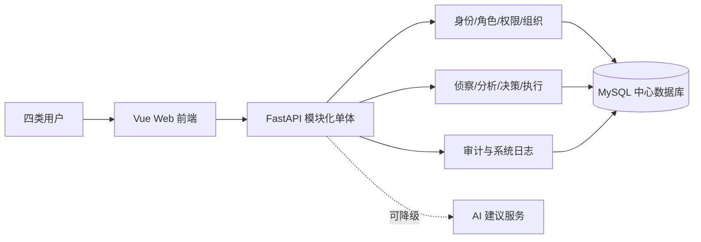
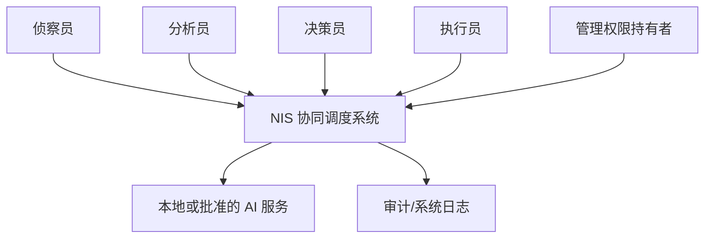
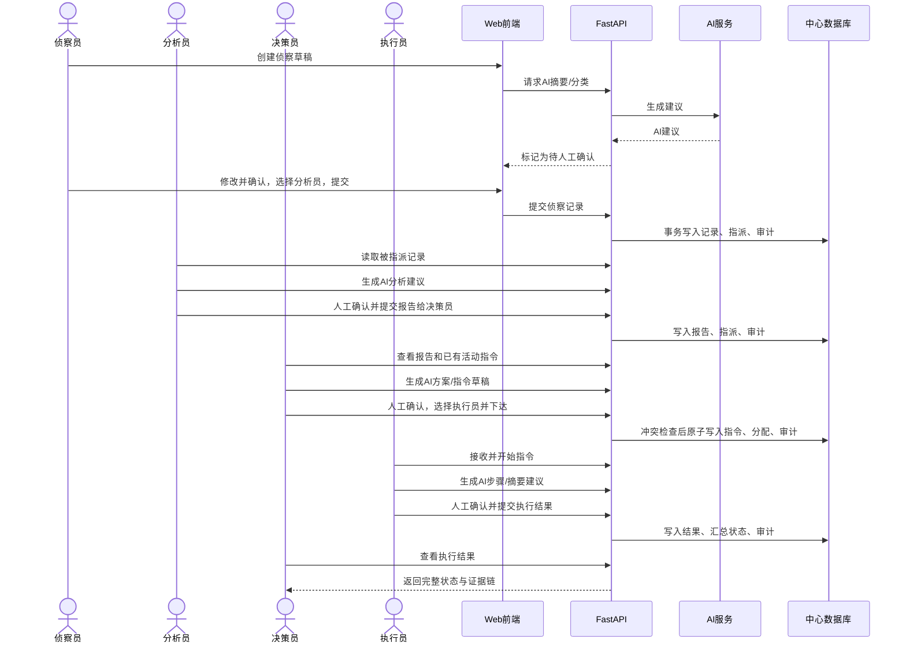
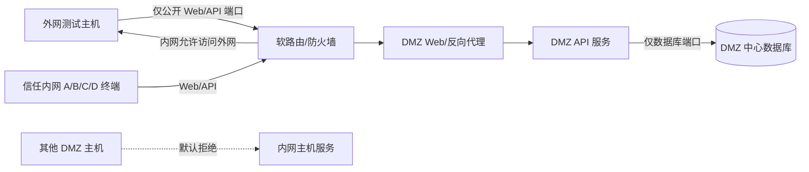

# 系统总体架构

版本：0.1（基线候选）

## 1. 架构目标

- 在课程周期内优先完成稳定的基础验收闭环。
- 服务端统一实施权限、业务状态和审计规则。
- 支持四台终端同时使用以及外网、DMZ、内网隔离验证。
- AI 服务是可降级的辅助依赖，不成为人工流程的单点阻塞。
- 代码、配置、测试和部署可通过 Git 追溯。

## 2. 架构风格

采用前后端分离的模块化单体：Vue 前端、FastAPI 应用、MySQL 中心数据库。模块化单体可以在一个服务中保持事务一致性和统一审计，复杂度适合四人课程项目；当前不拆微服务。

## 3. 系统上下文

系统只在授权实验环境中处理演示数据，不主动对第三方目标进行真实侦察或攻击。

## 4. 应用模块

| 模块 | 主要职责 | 数据所有权 |
|---|---|---|
| Identity & Access | 登录、用户、角色、权限、有效角色上下文 | 用户、角色、权限关系 |
| Organization | 组织单元、成员关系、候选接收人筛选 | 组织及成员关系 |
| Reconnaissance | 侦察草稿、提交、证据元数据、指派 | 侦察记录 |
| Analysis | 分析报告、关联记录、AI建议和人工确认 | 分析报告 |
| Decision | 方案比较、指令草稿、冲突检查和下达 | 决策指令 |
| Execution | 个人分配、接收、执行和结果 | 分配与执行结果 |
| AI Assistance | 统一生成建议、超时降级、来源记录 | AI 请求/建议元数据 |
| Audit | 操作审计、系统事件、追踪查询 | 审计日志 |

模块通过服务层调用，不允许路由处理器直接任意修改其他模块的数据表。

## 5. 完整业务时序

## 6. 网络与部署

验收材料要求 DMZ 主机不能访问内网服务。为避免应用服务器跨区访问内网数据库，本基线把公开入口、API 和中心数据库部署在 DMZ 服务侧的不同容器/虚拟机中；数据库端口不映射到外网，并只允许 API 主机访问。

安全规则：

- 外网只映射 Web/API 必需端口，禁止数据库和管理端口。
- 内网终端可访问外网和 DMZ 业务服务。
- DMZ 到信任内网默认全部拒绝。
- 数据库只接受 API 主机，使用独立低权限数据库账号。
- 管理入口只允许指定管理终端或通过虚拟机控制台。

若教师确认中心数据库必须位于信任内网，则必须先调整验收解释和网络方案，不能直接开通 DMZ 到内网而违反当前拒绝测试。

## 7. 故障边界与降级

| 故障 | 预期行为 |
|---|---|
| AI 服务超时/失败 | 显示 AI 不可用，人工编辑与业务提交继续可用 |
| 数据库不可用 | API 就绪检查失败；写操作明确失败并回滚，不产生半完成状态 |
| 重复网络请求 | 幂等机制返回原结果或冲突，不创建重复业务对象 |
| 前端暂时断网 | 保留未提交输入；恢复后由用户确认重试 |
| API 重启 | 已提交数据保存在数据库；客户端重新建立会话/请求 |
| 单个用户越权 | 后端拒绝并记录安全审计，不泄露目标资源内容 |

## 8. 技术选型

| 领域 | 选择 | 理由 |
|---|---|---|
| 前端 | Vue 3 + Vite + TypeScript | 轻量、开发反馈快、类型契约明确 |
| 后端 | FastAPI + Pydantic + SQLAlchemy | 自动 OpenAPI、输入验证清晰、适合模块化单体 |
| 数据库 | MySQL 8 | 满足关系、多对多、事务和中心数据库要求 |
| 迁移 | Alembic | 数据库演进可追溯、可部署 |
| 部署 | Docker Compose | 四人环境一致，便于在虚拟机复现 |
| 网络 | iKuai/等价软路由 + 独立虚拟网段 | 可演示 WAN/LAN/DMZ 和防火墙策略 |

## 9. 接口与数据基线评审

B 提交 ER 图和 OpenAPI 后，由 A 主持评审：

1. 角色、权限、组织关系满足多对多；
2. 状态枚举与 `workflow.md` 一致；
3. 资源具有所有者、指派关系、版本和审计字段；
4. C 能根据响应判断允许操作、AI确认和冲突；
5. D 能根据健康检查、端口和配置完成部署；
6. 破坏性变更通过 Issue 和 ADR 决策。

## 10. 架构决策记录

- ADR-001：采用模块化单体，而非微服务。
- ADR-002：应用与中心数据库位于 DMZ 服务侧，DMZ 不访问内网。
- ADR-003：AI 是可降级的建议服务，所有关键动作由人确认。

对应记录见：

- [ADR-001：采用模块化单体](adr/001-modular-monolith.md)
- [ADR-002：API 与中心数据库位于 DMZ 服务侧](adr/002-dmz-service-placement.md)
- [ADR-003：AI 为可降级建议服务](adr/003-human-in-the-loop-ai.md)
