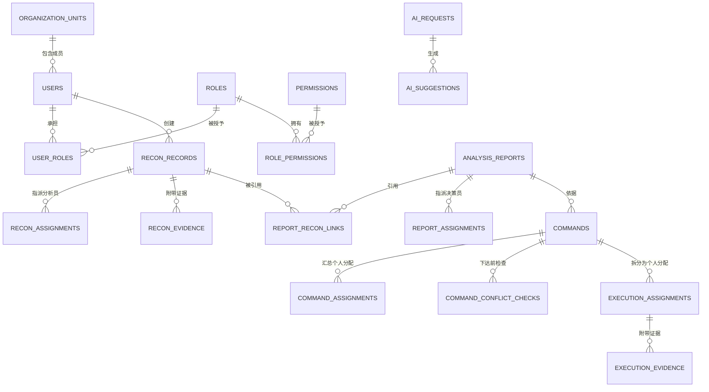

# 数据模型与 ER 设计

版本：0.1（接口与数据基线）

状态：A 起草，待 B 在实现前确认字段类型与索引

对应契约：[api-gateway.yaml](../contracts/openapi/api-gateway.yaml)、
[common.yaml](../contracts/schemas/common.yaml)、[服务目录](service-catalog.md)、
[数据所有权](data-ownership.md)、[业务状态机](workflow.md)。

本文件是“接口字段 → 数据库表字段”的唯一对照基线。前端字段、OpenAPI 字段、数据库
字段三处必须同名同义；任何改名都属于契约变更，必须走
[服务契约规范](service-contracts.md) 第 8 节的评审流程。

## 1. 总则

### 1.1 实例与 Schema

一个 MySQL 8 实例，按服务划分 7 个逻辑 Schema，Gateway 不拥有 Schema：

| Schema | 所属服务 | 表数 |
|---|---|---:|
| `nis_iam` | IAM & Organization | 6 |
| `nis_recon` | Reconnaissance | 3 |
| `nis_analysis` | Analysis | 3 |
| `nis_decision` | Decision | 3 |
| `nis_execution` | Execution | 2 |
| `nis_ai` | AI Assistance | 2 |
| `nis_audit` | Audit | 2 |

### 1.2 标识、时间与命名

- 主键统一 `id`，业务对外标识统一 UUID 字符串，数据库存 `CHAR(36)`。课程规模下不做
  `BINARY(16)` 压缩，换取排障时可读性。
- 所有时间列使用 `DATETIME(3)`，服务端统一写入 UTC；接口传输 ISO 8601 UTC。
- 表名与列名一律 `snake_case`，表名用复数，不使用 SQL 保留字。
- 人可读编号列（`record_no`、`report_no`、`command_no`）格式为
  `前缀-YYYYMMDD-四位序号`，例如 `REC-20261016-0001`，只用于展示与口头沟通，
  不能替代 `id` 作为接口标识。

### 1.3 标准头字段

除审计表外，每张业务表都包含下列列；下文各表不再重复列出：

| 列 | 类型 | 约束 | 说明 |
|---|---|---|---|
| `id` | `CHAR(36)` | PK | UUID |
| `version` | `INT UNSIGNED` | NOT NULL DEFAULT 1 | 乐观锁，每次成功更新 +1 |
| `created_at` | `DATETIME(3)` | NOT NULL | 创建时间（UTC） |
| `created_by` | `CHAR(36)` | NOT NULL | 创建者用户 UUID |
| `updated_at` | `DATETIME(3)` | NOT NULL | 最后修改时间 |
| `updated_by` | `CHAR(36)` | NOT NULL | 最后修改者用户 UUID |

只追加、不允许更新的表（审计事件、证据元数据）不设 `version`/`updated_*`。

### 1.4 跨服务引用

- 不建立跨 Schema 外键。跨服务引用只保存对方 UUID，引用有效性由接口校验保证。
- 为展示稳定，接收方可以保存**不可变快照列**（标题、作者显示名、优先级），并在列名
  加 `_snapshot` 后缀。实时状态必须回源查询，不能用快照冒充。
- 上游对象删除一律采用停用、归档或软删除，避免悬空引用。

### 1.5 索引原则

- 每个外键式引用列建普通索引。
- 列表页固定按 `(owner/executor, status, created_at DESC)` 建复合索引。
- 唯一约束优先在数据库层实现：用户名、角色代码、权限代码、`(user_id, role_id)`、
  `(role_id, permission_id)`、幂等键。
- 不做无查询依据的“防御性索引”；索引变更由 B 在迁移文件中说明原因。

## 2. 全局 ER 图

实线为同 Schema 内引用，虚线为跨服务引用（只存 UUID，不建外键）。



跨服务引用关系（虚线）：

```text
recon_assignments.analyst_id        -> nis_iam.users.id
recon_records.owner_id              -> nis_iam.users.id
report_recon_links.recon_record_id  -> nis_recon.recon_records.id
report_assignments.decision_maker_id-> nis_iam.users.id
commands.decision_maker_id          -> nis_iam.users.id
commands.source_report_id           -> nis_analysis.analysis_reports.id
command_assignments.executor_id     -> nis_iam.users.id
execution_assignments.executor_id   -> nis_iam.users.id
ai_suggestions.business_object_id   -> 对应环节业务对象 UUID，只作来源引用
audit_events.resource_id            -> 任意业务对象 UUID，只作追溯
```

## 3. 枚举与状态字典

枚举取值与 [common.yaml](../contracts/schemas/common.yaml) 严格一致；状态转换见
[workflow.md](workflow.md)。数据库中枚举以 `VARCHAR(32)` 保存代码值，不使用 MySQL
`ENUM`，避免状态扩展时锁表迁移。

| 枚举 | 取值 | 说明 |
|---|---|---|
| 角色 `role.code` | `reconnaissance`、`analyst`、`decision_maker`、`executor` | 四类标准业务角色 |
| 优先级 | `normal`、`urgent` | 紧急任务需优先排序并醒目提示 |
| 账号状态 | `active`、`disabled`、`locked` | 后两者禁止登录与续签 |
| 可信度 | `high`、`medium`、`low`、`unverified` | 侦察员填写，AI 只能建议 |
| 侦察状态 | `draft`、`submitting`、`assigned`、`under_analysis`、`analyzed`、`rejected`、`compensation_required` | 记录级状态 |
| 报告状态 | `draft`、`submitting`、`assigned`、`under_decision`、`decided`、`rejected`、`compensation_required` | 报告级状态 |
| 指令状态 | `draft`、`issuing`、`issued`、`partially_accepted`、`accepted`、`executing`、`partially_completed`、`completed`、`failed`、`rejected`、`cancelled`、`compensation_required` | 汇总状态 |
| 分配状态 | `pending`、`accepted`、`executing`、`completed`、`failed`、`rejected`、`cancelled` | 个人状态 |
| 分析员处理状态 | `pending`、`in_progress`、`completed`、`rejected` | `recon_assignments.status` |
| 执行结论 | `success`、`failure`、`partial` | 只在完成或失败提交时写入 |
| 风险等级 | `low`、`medium`、`high` | 报告字段 |
| AI 环节 | `recon`、`analysis`、`decision`、`execution` | 四环节统一适配 |
| AI 建议状态 | `pending`、`accepted`、`edited`、`rejected` | 人工处理结果 |
| 审计类型 | `user_operation`、`system_event`、`security_event` | 事件分类 |
| 审计结果 | `success`、`failure`、`denied` | `denied` 用于越权尝试 |
| 组织类型 | `command`、`staff`、`recon_team`、`analysis_team`、`execution_team` | 组织结构 |
| 来源类型 | `osint`、`sensor`、`report`、`document`、`other` | 侦察来源 |
| 权限域 | `recon`、`analysis`、`command`、`execution`、`ai`、`audit`、`iam`、`organization` | 管理界面分组 |

## 4. `nis_iam`

### 4.1 `organization_units`

| 列 | 类型 | 约束 | 说明 |
|---|---|---|---|
| `id` | `CHAR(36)` | PK | |
| `parent_id` | `CHAR(36)` | NULL, FK→本表 | 根节点为空 |
| `code` | `VARCHAR(64)` | NOT NULL, UNIQUE | 稳定编码，候选筛选与配置使用 |
| `name` | `VARCHAR(128)` | NOT NULL | 显示名 |
| `unit_type` | `VARCHAR(32)` | NOT NULL | 见组织类型枚举 |
| `path` | `VARCHAR(512)` | NOT NULL | 物化路径 `/root/child/`，便于一次性取子树 |
| `sort_order` | `INT` | NOT NULL DEFAULT 0 | 展示顺序 |
| `is_active` | `TINYINT(1)` | NOT NULL DEFAULT 1 | 停用后不再作为候选来源 |

索引：`UNIQUE(code)`、`INDEX(parent_id)`、`INDEX(path(191))`。

### 4.2 `users`

| 列 | 类型 | 约束 | 说明 |
|---|---|---|---|
| `id` | `CHAR(36)` | PK | |
| `username` | `VARCHAR(64)` | NOT NULL, UNIQUE | 登录名 |
| `password_hash` | `VARCHAR(255)` | NOT NULL | 自适应哈希（bcrypt/argon2），禁止明文与可逆加密 |
| `display_name` | `VARCHAR(64)` | NOT NULL | 显示名 |
| `status` | `VARCHAR(16)` | NOT NULL DEFAULT 'active' | 见账号状态枚举 |
| `organization_id` | `CHAR(36)` | NOT NULL, FK→organization_units | 主组织，一人一主组织 |
| `failed_login_count` | `INT` | NOT NULL DEFAULT 0 | 连续失败计数 |
| `locked_until` | `DATETIME(3)` | NULL | 锁定截止时间 |
| `last_login_at` | `DATETIME(3)` | NULL | 最近成功登录 |
| `password_changed_at` | `DATETIME(3)` | NULL | 用于提示改密 |

索引：`UNIQUE(username)`、`INDEX(organization_id, status)`。

### 4.3 `roles`

| 列 | 类型 | 约束 | 说明 |
|---|---|---|---|
| `id` | `CHAR(36)` | PK | |
| `code` | `VARCHAR(32)` | NOT NULL, UNIQUE | 四类标准角色代码或自定义代码 |
| `name` | `VARCHAR(64)` | NOT NULL | |
| `description` | `VARCHAR(255)` | NULL | |
| `is_system` | `TINYINT(1)` | NOT NULL DEFAULT 0 | 标准角色为 1，不允许删除 |

### 4.4 `permissions`

| 列 | 类型 | 约束 | 说明 |
|---|---|---|---|
| `id` | `CHAR(36)` | PK | |
| `code` | `VARCHAR(64)` | NOT NULL, UNIQUE | 与 [rbac.md](rbac.md) 权限代码一致 |
| `name` | `VARCHAR(64)` | NOT NULL | |
| `domain` | `VARCHAR(32)` | NOT NULL | 见权限域枚举 |

### 4.5 `user_roles`

| 列 | 类型 | 约束 | 说明 |
|---|---|---|---|
| `id` | `CHAR(36)` | PK | |
| `user_id` | `CHAR(36)` | NOT NULL, FK→users | |
| `role_id` | `CHAR(36)` | NOT NULL, FK→roles | |
| `granted_by` | `CHAR(36)` | NOT NULL | 授权操作者 |
| `granted_at` | `DATETIME(3)` | NOT NULL | |
| `expires_at` | `DATETIME(3)` | NULL | 限时角色预留；到期即视为无效 |

索引：`UNIQUE(user_id, role_id)`、`INDEX(role_id)`、`INDEX(expires_at)`。

### 4.6 `role_permissions`

| 列 | 类型 | 约束 | 说明 |
|---|---|---|---|
| `id` | `CHAR(36)` | PK | |
| `role_id` | `CHAR(36)` | NOT NULL, FK→roles | |
| `permission_id` | `CHAR(36)` | NOT NULL, FK→permissions | |
| `granted_at` | `DATETIME(3)` | NOT NULL | |

索引：`UNIQUE(role_id, permission_id)`、`INDEX(permission_id)`。

## 5. `nis_recon`

### 5.1 `recon_records`

| 列 | 类型 | 约束 | 说明 |
|---|---|---|---|
| `id` | `CHAR(36)` | PK | |
| `record_no` | `VARCHAR(32)` | NOT NULL, UNIQUE | 人可读编号 |
| `title` | `VARCHAR(200)` | NOT NULL | |
| `source_type` | `VARCHAR(32)` | NOT NULL | 见来源类型枚举 |
| `source_ref` | `VARCHAR(500)` | NULL | 脱敏来源说明，不写真实敏感地址 |
| `content` | `TEXT` | NOT NULL | 侦察正文 |
| `credibility` | `VARCHAR(16)` | NOT NULL | 可信度 |
| `priority` | `VARCHAR(16)` | NOT NULL DEFAULT 'normal' | 优先级 |
| `status` | `VARCHAR(32)` | NOT NULL DEFAULT 'draft' | 侦察状态 |
| `owner_id` | `CHAR(36)` | NOT NULL | 侦察员 UUID（跨服务引用） |
| `organization_id` | `CHAR(36)` | NOT NULL | 提交时所属组织快照 |
| `submitted_at` | `DATETIME(3)` | NULL | 提交时间 |
| `last_request_id` | `CHAR(36)` | NULL | 最近一次提交的追踪 ID，便于审计关联 |

索引：`UNIQUE(record_no)`、`INDEX(owner_id, status, updated_at)`、
`INDEX(organization_id, status)`、`INDEX(last_request_id)`。

### 5.2 `recon_assignments`

| 列 | 类型 | 约束 | 说明 |
|---|---|---|---|
| `id` | `CHAR(36)` | PK | |
| `record_id` | `CHAR(36)` | NOT NULL, FK→recon_records | |
| `analyst_id` | `CHAR(36)` | NOT NULL | 分析员 UUID（跨服务引用） |
| `status` | `VARCHAR(16)` | NOT NULL DEFAULT 'pending' | `pending`/`in_progress`/`completed`/`rejected` |
| `assigned_by` | `CHAR(36)` | NOT NULL | 指派操作者，通常为提交记录本人 |
| `assigned_at` | `DATETIME(3)` | NOT NULL | |
| `responded_at` | `DATETIME(3)` | NULL | 拒绝或完成时间 |
| `reject_reason` | `VARCHAR(500)` | NULL | 拒绝理由，状态为 rejected 时必填 |

索引：`UNIQUE(record_id, analyst_id)`、`INDEX(analyst_id, status)`。

### 5.3 `recon_evidence`

只追加，不更新。

| 列 | 类型 | 约束 | 说明 |
|---|---|---|---|
| `id` | `CHAR(36)` | PK | |
| `record_id` | `CHAR(36)` | NOT NULL, FK→recon_records | |
| `file_name` | `VARCHAR(255)` | NOT NULL | 原始文件名 |
| `media_type` | `VARCHAR(127)` | NOT NULL | |
| `size_bytes` | `BIGINT` | NOT NULL DEFAULT 0 | |
| `sha256` | `CHAR(64)` | NOT NULL | 完整性校验 |
| `storage_ref` | `VARCHAR(512)` | NOT NULL | 受控存储引用，不落绝对路径 |
| `uploaded_by` | `CHAR(36)` | NOT NULL | |
| `created_at` | `DATETIME(3)` | NOT NULL | |

索引：`INDEX(record_id)`、`INDEX(sha256)`。

## 6. `nis_analysis`

### 6.1 `analysis_reports`

| 列 | 类型 | 约束 | 说明 |
|---|---|---|---|
| `id` | `CHAR(36)` | PK | |
| `report_no` | `VARCHAR(32)` | NOT NULL, UNIQUE | |
| `title` | `VARCHAR(200)` | NOT NULL | |
| `status` | `VARCHAR(32)` | NOT NULL DEFAULT 'draft' | 报告状态 |
| `author_id` | `CHAR(36)` | NOT NULL | 分析员 UUID |
| `organization_id` | `CHAR(36)` | NOT NULL | 所属组织快照 |
| `key_findings` | `TEXT` | NOT NULL | 关键发现 |
| `relations` | `TEXT` | NULL | 信息关联关系 |
| `risk_level` | `VARCHAR(16)` | NOT NULL DEFAULT 'medium' | 风险等级 |
| `recommended_actions` | `TEXT` | NOT NULL | 建议手段 |
| `priority` | `VARCHAR(16)` | NOT NULL DEFAULT 'normal' | |
| `ai_content_confirmed` | `TINYINT(1)` | NOT NULL DEFAULT 0 | AI 内容是否已全部处理，提交前置条件 |
| `human_confirmed` | `TINYINT(1)` | NOT NULL DEFAULT 0 | 人工确认标志 |
| `confirmed_by` | `CHAR(36)` | NULL | |
| `confirmed_at` | `DATETIME(3)` | NULL | |
| `submitted_at` | `DATETIME(3)` | NULL | |
| `last_request_id` | `CHAR(36)` | NULL | |

索引：`UNIQUE(report_no)`、`INDEX(author_id, status, updated_at)`、
`INDEX(organization_id, status)`。

### 6.2 `report_recon_links`

| 列 | 类型 | 约束 | 说明 |
|---|---|---|---|
| `id` | `CHAR(36)` | PK | |
| `report_id` | `CHAR(36)` | NOT NULL, FK→analysis_reports | |
| `recon_record_id` | `CHAR(36)` | NOT NULL | 侦察记录 UUID（跨服务引用） |
| `recon_title_snapshot` | `VARCHAR(200)` | NOT NULL | 不可变标题快照 |
| `recon_owner_snapshot` | `VARCHAR(64)` | NULL | 侦察员显示名快照 |
| `recon_priority_snapshot` | `VARCHAR(16)` | NULL | 优先级快照 |
| `linked_at` | `DATETIME(3)` | NOT NULL | |

索引：`UNIQUE(report_id, recon_record_id)`、`INDEX(recon_record_id)`。

### 6.3 `report_assignments`

| 列 | 类型 | 约束 | 说明 |
|---|---|---|---|
| `id` | `CHAR(36)` | PK | |
| `report_id` | `CHAR(36)` | NOT NULL, FK→analysis_reports | |
| `decision_maker_id` | `CHAR(36)` | NOT NULL | 决策员 UUID（跨服务引用） |
| `status` | `VARCHAR(16)` | NOT NULL DEFAULT 'pending' | `pending`/`in_progress`/`completed`/`rejected` |
| `assigned_by` | `CHAR(36)` | NOT NULL | |
| `assigned_at` | `DATETIME(3)` | NOT NULL | |
| `responded_at` | `DATETIME(3)` | NULL | |
| `reject_reason` | `VARCHAR(500)` | NULL | |

索引：`UNIQUE(report_id, decision_maker_id)`、`INDEX(decision_maker_id, status)`。

## 7. `nis_decision`

### 7.1 `commands`

| 列 | 类型 | 约束 | 说明 |
|---|---|---|---|
| `id` | `CHAR(36)` | PK | |
| `command_no` | `VARCHAR(32)` | NOT NULL, UNIQUE | |
| `title` | `VARCHAR(200)` | NOT NULL | |
| `objective` | `VARCHAR(500)` | NOT NULL | 行动目标 |
| `content` | `TEXT` | NOT NULL | 指令正文 |
| `priority` | `VARCHAR(16)` | NOT NULL DEFAULT 'normal' | |
| `deadline` | `DATETIME(3)` | NULL | 截止时间 |
| `status` | `VARCHAR(32)` | NOT NULL DEFAULT 'draft' | 指令总体状态 |
| `decision_maker_id` | `CHAR(36)` | NOT NULL | 决策员 UUID |
| `organization_id` | `CHAR(36)` | NOT NULL | |
| `source_report_id` | `CHAR(36)` | NOT NULL | 依据报告 UUID（跨服务引用） |
| `issued_at` | `DATETIME(3)` | NULL | |
| `cancelled_at` | `DATETIME(3)` | NULL | |
| `cancel_reason` | `VARCHAR(500)` | NULL | |
| `last_request_id` | `CHAR(36)` | NULL | |

索引：`UNIQUE(command_no)`、`INDEX(decision_maker_id, status, updated_at)`、
`INDEX(source_report_id, status)`。

### 7.2 `command_assignments`

Decision Service 只保存个人分配的**状态摘要**；执行结果明细属于 `nis_execution`。

| 列 | 类型 | 约束 | 说明 |
|---|---|---|---|
| `id` | `CHAR(36)` | PK | |
| `command_id` | `CHAR(36)` | NOT NULL, FK→commands | |
| `assignment_id` | `CHAR(36)` | NOT NULL | Execution 侧分配 UUID |
| `executor_id` | `CHAR(36)` | NOT NULL | 执行员 UUID |
| `status` | `VARCHAR(16)` | NOT NULL DEFAULT 'pending' | 分配状态副本，由 Execution 回写 |
| `updated_at` | `DATETIME(3)` | NOT NULL | |

索引：`UNIQUE(command_id, executor_id)`、`UNIQUE(assignment_id)`、
`INDEX(executor_id, status)`。

### 7.3 `command_conflict_checks`

| 列 | 类型 | 约束 | 说明 |
|---|---|---|---|
| `id` | `CHAR(36)` | PK | |
| `command_id` | `CHAR(36)` | NOT NULL, FK→commands | |
| `checked_at` | `DATETIME(3)` | NOT NULL | |
| `checked_by` | `CHAR(36)` | NOT NULL | 决策员 UUID |
| `conflict_type` | `VARCHAR(32)` | NOT NULL | 例如 `same_objective_active_command` |
| `matched_command_ids` | `JSON` | NOT NULL | 命中的活动指令 UUID 数组 |
| `decision` | `VARCHAR(16)` | NOT NULL | `proceed` 或 `cancel` |
| `reason` | `VARCHAR(500)` | NULL | |

索引：`INDEX(command_id)`、`INDEX(matched_command_ids(191))`（MySQL 8 函数索引或
生成列，由 B 决定实现方式）。

## 8. `nis_execution`

### 8.1 `execution_assignments`

| 列 | 类型 | 约束 | 说明 |
|---|---|---|---|
| `id` | `CHAR(36)` | PK | |
| `command_id` | `CHAR(36)` | NOT NULL | 指令 UUID（跨服务引用） |
| `command_title_snapshot` | `VARCHAR(200)` | NOT NULL | 下达时标题快照 |
| `command_content_snapshot` | `TEXT` | NULL | 下达时正文快照 |
| `priority` | `VARCHAR(16)` | NOT NULL DEFAULT 'normal' | |
| `deadline` | `DATETIME(3)` | NULL | |
| `executor_id` | `CHAR(36)` | NOT NULL | 执行员 UUID |
| `status` | `VARCHAR(16)` | NOT NULL DEFAULT 'pending' | 分配状态 |
| `accepted_at` | `DATETIME(3)` | NULL | |
| `started_at` | `DATETIME(3)` | NULL | |
| `completed_at` | `DATETIME(3)` | NULL | |
| `reject_reason` | `VARCHAR(500)` | NULL | |
| `result_outcome` | `VARCHAR(16)` | NULL | 执行结论 |
| `result_summary` | `VARCHAR(2000)` | NULL | 结果摘要 |
| `result_detail` | `TEXT` | NULL | 结果详情 |
| `reported_at` | `DATETIME(3)` | NULL | 结果上报时间 |
| `reported_by` | `CHAR(36)` | NULL | |
| `idempotency_key` | `VARCHAR(128)` | NULL | 结果提交幂等键 |

索引：`UNIQUE(command_id, executor_id)`、`INDEX(executor_id, status, updated_at)`、
`UNIQUE(idempotency_key)`。

约束：`status IN ('completed','failed')` 时 `result_outcome` 与 `reported_at` 必须非空
（应用层校验 + 可选 CHECK 约束）。

### 8.2 `execution_evidence`

只追加，不更新。

| 列 | 类型 | 约束 | 说明 |
|---|---|---|---|
| `id` | `CHAR(36)` | PK | |
| `assignment_id` | `CHAR(36)` | NOT NULL, FK→execution_assignments | |
| `file_name` | `VARCHAR(255)` | NOT NULL | |
| `media_type` | `VARCHAR(127)` | NOT NULL | |
| `size_bytes` | `BIGINT` | NOT NULL DEFAULT 0 | |
| `sha256` | `CHAR(64)` | NOT NULL | |
| `storage_ref` | `VARCHAR(512)` | NOT NULL | |
| `uploaded_by` | `CHAR(36)` | NOT NULL | |
| `created_at` | `DATETIME(3)` | NOT NULL | |

索引：`INDEX(assignment_id)`。

## 9. `nis_ai`

### 9.1 `ai_requests`

| 列 | 类型 | 约束 | 说明 |
|---|---|---|---|
| `id` | `CHAR(36)` | PK | |
| `stage` | `VARCHAR(16)` | NOT NULL | AI 环节 |
| `business_object_type` | `VARCHAR(32)` | NOT NULL | `recon_record` 等 |
| `business_object_id` | `CHAR(36)` | NOT NULL | 来源对象 UUID |
| `suggestion_type` | `VARCHAR(32)` | NOT NULL | 建议类型 |
| `requested_by` | `CHAR(36)` | NOT NULL | 发起用户 |
| `input_digest` | `CHAR(64)` | NULL | 输入摘要，不保存越权原文 |
| `model_name` | `VARCHAR(64)` | NULL | |
| `model_version` | `VARCHAR(64)` | NULL | |
| `status` | `VARCHAR(16)` | NOT NULL | `pending`/`succeeded`/`failed`/`timeout` |
| `latency_ms` | `INT` | NULL | |
| `error_code` | `VARCHAR(64)` | NULL | |
| `requested_at` | `DATETIME(3)` | NOT NULL | |

索引：`INDEX(business_object_type, business_object_id, requested_at)`。

### 9.2 `ai_suggestions`

| 列 | 类型 | 约束 | 说明 |
|---|---|---|---|
| `id` | `CHAR(36)` | PK | |
| `request_id` | `CHAR(36)` | NOT NULL, FK→ai_requests | |
| `stage` | `VARCHAR(16)` | NOT NULL | |
| `suggestion_type` | `VARCHAR(32)` | NOT NULL | |
| `content` | `JSON` | NOT NULL | 结构化建议原文，不可直接驱动状态 |
| `confidence` | `DECIMAL(4,3)` | NULL | 0 至 1 |
| `source_refs` | `JSON` | NULL | 引用来源数组 |
| `status` | `VARCHAR(16)` | NOT NULL DEFAULT 'pending' | 人工处理结果 |
| `human_confirmed_by` | `CHAR(36)` | NULL | 确认人 |
| `human_confirmed_at` | `DATETIME(3)` | NULL | 确认时间 |
| `edited_content` | `JSON` | NULL | 人工修改后的最终内容 |

索引：`INDEX(request_id)`、`INDEX(status)`。

约束：`status IN ('accepted','edited')` 时 `human_confirmed_by`、`human_confirmed_at`
必须非空；业务服务只能读取 `accepted`/`edited` 且已确认的内容。

## 10. `nis_audit`

### 10.1 `audit_events`

只追加。任何服务账号都不拥有 `UPDATE`/`DELETE` 权限。

| 列 | 类型 | 约束 | 说明 |
|---|---|---|---|
| `id` | `BIGINT UNSIGNED` | PK AUTO_INCREMENT | 单调递增，用于稳定排序 |
| `request_id` | `CHAR(36)` | NOT NULL | 全链路追踪 ID |
| `occurred_at` | `DATETIME(3)` | NOT NULL | 事件时间（服务端时钟） |
| `service` | `VARCHAR(64)` | NOT NULL | 产生事件的服务 |
| `event_type` | `VARCHAR(32)` | NOT NULL | 审计类型 |
| `actor_user_id` | `CHAR(36)` | NULL | 最终操作者，禁止用服务账号替代 |
| `actor_role` | `VARCHAR(32)` | NULL | 操作时的角色上下文 |
| `actor_organization_id` | `CHAR(36)` | NULL | |
| `action` | `VARCHAR(64)` | NOT NULL | 稳定动作名，例如 `recon_record.submit` |
| `resource_type` | `VARCHAR(64)` | NULL | |
| `resource_id` | `CHAR(36)` | NULL | |
| `result` | `VARCHAR(16)` | NOT NULL | 审计结果 |
| `error_code` | `VARCHAR(64)` | NULL | 失败时的稳定错误码 |
| `source_ip` | `VARCHAR(64)` | NULL | |
| `user_agent` | `VARCHAR(300)` | NULL | |
| `service_identity` | `VARCHAR(64)` | NULL | 调用方服务身份 |
| `details` | `JSON` | NULL | 结构化补充信息，禁止密码、Token、完整敏感正文 |
| `payload_digest` | `CHAR(64)` | NULL | 请求正文摘要 |

索引：`INDEX(request_id, id)`、`INDEX(resource_type, resource_id, id)`、
`INDEX(actor_user_id, occurred_at)`、`INDEX(occurred_at)`。

### 10.2 `audit_trace_index`

| 列 | 类型 | 约束 | 说明 |
|---|---|---|---|
| `request_id` | `CHAR(36)` | PK | 一次业务动作 |
| `root_action` | `VARCHAR(64)` | NOT NULL | 触发动作 |
| `started_at` | `DATETIME(3)` | NOT NULL | |
| `completed_at` | `DATETIME(3)` | NULL | 未完成则为空 |
| `event_count` | `INT` | NOT NULL DEFAULT 0 | |
| `outcome` | `VARCHAR(16)` | NULL | 汇总结果 |

## 11. 候选接收人查询口径

候选列表由 IAM Service 提供，筛选口径必须写死在服务端，不能由前端传任意条件放宽：

```sql
-- 例：为侦察记录挑选分析员候选
SELECT u.id,
       u.display_name,
       u.organization_id,
       ou.name AS organization_name
FROM nis_iam.users u
JOIN nis_iam.organization_units ou ON ou.id = u.organization_id
JOIN nis_iam.user_roles ur        ON ur.user_id = u.id
JOIN nis_iam.roles r              ON r.id = ur.role_id
WHERE u.status = 'active'
  AND r.code = 'analyst'                       -- 目标角色
  AND (ur.expires_at IS NULL OR ur.expires_at > UTC_TIMESTAMP(3))
  AND ou.is_active = 1
  AND ou.path LIKE CONCAT(:source_path, '%')    -- 组织规则：同一或下属组织
ORDER BY ou.sort_order, u.display_name;
```

规则：

1. `target_role` 必须是四类标准角色之一或已配置的业务角色；
2. 组织范围默认取“来源对象所属组织的子树”，跨组织指派需要明确规则；
3. 停用账号、过期角色、停用组织一律不返回；
4. 候选列表只用于选择，真正的合法性仍在提交时由 `users/resolve` 再校验一次。

## 12. 初始化与迁移顺序

每个服务独立 Alembic 目录；统一按下列顺序部署，避免跨服务引用在目标 Schema 尚不
存在时被写入：

1. `nis_iam`（组织、用户、角色、权限、关联表）
2. `nis_audit`（先能记录事件，便于后续服务启动即写审计）
3. `nis_recon`、`nis_analysis`、`nis_decision`、`nis_execution`
4. `nis_ai`
5. 种子数据：组织 → 权限 → 角色 → 角色权限 → 用户 → 用户角色

数据库账号按 Schema 授权：每个服务账号只拥有自己 Schema 的
`SELECT/INSERT/UPDATE/DELETE` 与迁移所需 DDL；`nis_audit` 的账号不授予
`UPDATE`/`DELETE`。

## 13. 与接口契约的对应关系

| 契约位置 | 数据位置 | 说明 |
|---|---|---|
| `api-gateway.yaml#/components/schemas/ReconRecord` | `nis_recon.recon_records` + `recon_assignments` + `recon_evidence` | 聚合返回 |
| `AnalysisReport` | `nis_analysis.analysis_reports` + `report_recon_links` + `report_assignments` | 聚合返回 |
| `Command` | `nis_decision.commands` + `command_assignments` | 聚合返回 |
| `Assignment` | `nis_execution.execution_assignments` + `execution_evidence` | 聚合返回 |
| `AISuggestion` | `nis_ai.ai_suggestions` | 一对一 |
| `AuditEvent` | `nis_audit.audit_events` | 一对一 |

接口返回的聚合视图允许一次读取多张同 Schema 表；不允许跨 Schema JOIN。

## 14. 待 B 确认

1. UUID 是否统一使用 UUIDv7（按时间有序，利于索引局部性）；
2. `command_conflict_checks.matched_command_ids` 的索引实现方式（生成列或函数索引）；
3. 证据文件的实际存储位置与下载鉴权方式（对象存储、受控目录或附件服务）；
4. 是否需要在 `execution_assignments` 上增加 `deadline_warned_at` 以支持超时提醒。
