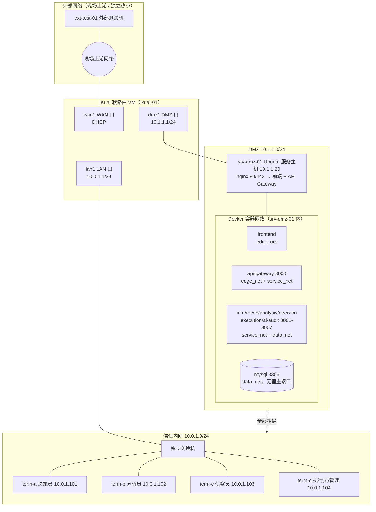

# 网络设计与地址规划

版本：1.0
负责人：D（评审：A）
关联 Issue：#16（Closes #16）
依据：[architecture §11](architecture.md)、[ADR-002](adr/002-dmz-service-placement.md)、
[network-lab-plan](network-lab-plan.md)、[soa-deployment](soa-deployment.md)

本文是三域网络、地址规划、防火墙策略和端口映射的**唯一权威来源**。
iKuai 实际配置步骤见 [deploy/network/ikuai-setup.md](../deploy/network/ikuai-setup.md)，
验证用例见 [tests/network/](../tests/network/README.md)。

## 1. 目标、假设与限制

目标：

1. 建立外部网络、信任内网、DMZ 三个物理/逻辑区域，区域间流量全部经过软路由防火墙；
2. 外部与内网用户只能访问 Gateway 对外发布的 Web/API（80/443）；
3. DMZ 到信任内网**全部拒绝**，无需为数据库开任何例外（依据 ADR-002）；
4. 每条策略有编号、理由和对应验证用例，允许与拒绝都能在防火墙日志中复现；
5. 另一名成员仅凭本文与 iKuai 配置文档可以重建整套网络。

假设：

- 使用一台基础设施主机（D 的电脑）承载软路由虚拟机与 DMZ 服务虚拟机/容器；
- 四台成员终端经交换机接入信任内网；
- 现场提供一个"外部网络"（实验室网线、独立热点或校园网）用于外部测试机。

限制与说明：

- iKuai WAN 地址取决于现场网络，本文以 `wan1(DHCP)` 参数化，实际值见 §11 待确认项；
- 课程现场如无法提供真实外部网络，以一台接入了不同上游（例如手机热点）的测试机
  充当外部网络，并在测试报告中注明；
- 数据库与 API 均位于 DMZ 服务侧（ADR-002）。`network-lab-plan.md` 中"数据库
  10.0.1.20 放内网"的示例**不再适用**，10.0.1.1.20 一段地址保留但本阶段不使用。

## 2. 区域与拓扑

要点：

- 三域互访的唯一转发点是 iKuai；交换机不提供任何跨段能力；
- MySQL 只存在于 `data_net` 内部网络，不映射宿主机端口，外部、内网、DMZ 其他主机
  都无法直连，数据库暴露面收敛到容器网络内部；
- 前端与 Gateway 在 `edge_net`，业务服务在 `service_net`（internal），数据库在
  `data_net`（internal），层次见 [soa-deployment §2](soa-deployment.md)。

## 3. 接口规划（iKuai）

| 接口 | 区域 | 地址 | 掩码 | DHCP | 用途 |
|---|---|---|---|---|---|
| `wan1` | 外部 | DHCP（现场分配） | /24 视现场 | 客户端 | 连接现场上游网络 |
| `lan1` | 信任内网 | 10.0.1.1 | 255.255.255.0 | 服务端 10.0.1.200-10.0.1.249 | 内网网关/DNS |
| `dmz1` | DMZ | 10.1.1.1 | 255.255.255.0 | 关闭 | DMZ 网关 |

- `lan1` DHCP 为访客/临时终端预留；四台成员终端与服务器全部使用静态地址（见 §4）；
- iKuai 自身作为内网 DNS 转发器（终端 DNS 指向 10.0.1.1）；
- iKuai 管理界面只监听 `lan1`，仅允许 10.0.1.104 访问（见 §7 FW-09）。

## 4. 节点清单

| 节点名 | 区域 | 地址/掩码 | 网关 | DNS | 开放端口（对外） | 管理方式 | 用途 |
|---|---|---|---|---|---|---|---|
| ikuai-01 | 边界 | wan1 DHCP / 10.0.1.1 / 10.1.1.1 | 上游网关 | 上游 | 无 | 仅 lan1 HTTPS，限 10.0.1.104 | 软路由/防火墙 |
| srv-dmz-01 | DMZ | 10.1.1.20/24 | 10.1.1.1 | 10.1.1.1 | tcp 80, 443（nginx） | SSH 22，仅 10.0.1.104 | 应用+数据库容器宿主机 |
| term-a | 内网 | 10.0.1.101/24 | 10.0.1.1 | 10.0.1.1 | - | 本机 | 决策员终端 |
| term-b | 内网 | 10.0.1.102/24 | 10.0.1.1 | 10.0.1.1 | - | 本机 | 分析员终端 |
| term-c | 内网 | 10.0.1.103/24 | 10.0.1.1 | 10.0.1.1 | - | 本机 | 侦察员终端 |
| term-d | 内网 | 10.0.1.104/24 | 10.0.1.1 | 10.0.1.1 | - | 本机 | 执行员终端 + 唯一管理终端 |
| ext-test-01 | 外部 | 现场分配 | 现场网关 | 现场DNS | - | 本机 | 外部访问验证 |

容器级节点（不占用户网段 IP，仅在 srv-dmz-01 的 Docker 网络内）：

| 容器 | Docker 网络 | 容器内端口 | 宿主映射 | 说明 |
|---|---|---:|---|---|
| nginx（边缘入口） | edge_net | 80/443 | 0.0.0.0:80、0.0.0.0:443 | 唯一对外入口，转发 `/`→前端、`/api/v1/`→Gateway |
| frontend | edge_net | 80 | 无 | Vue 静态站点 |
| api-gateway | edge_net + service_net | 8000 | 无 | 统一 API 入口 |
| iam/recon/analysis/decision/execution/ai/audit | service_net + data_net | 8001-8007 | 无 | 业务服务 |
| mysql | data_net | 3306 | 无 | 中心数据库 |

## 5. 数据流矩阵

区域级矩阵（"允许"必须在 §6 有对应规则；"拒绝"为默认或显式拒绝）：

| # | 源 | 目的 | 协议:端口 | 方向 | 策略 | 理由 | 验证用例 |
|---|---|---|---|---|---|---|---|
| DF-01 | 内网终端 | srv-dmz-01 | tcp 80/443 | →DMZ | 允许 | 用户访问 Web/API 唯一入口 | [TC-B04](../tests/network/tc-b04_lan-to-dmz-and-internet.md) |
| DF-02 | 内网终端 | 任意外网 | any | →WAN | 允许 | 更新、依赖下载、NTP | [TC-B04](../tests/network/tc-b04_lan-to-dmz-and-internet.md) |
| DF-03 | 外部 | srv-dmz-01 | tcp 80/443 | →DMZ | 允许（仅映射端口） | 验收要求外网可访问 DMZ 公开服务 | [TC-B05](../tests/network/tc-b05_external-to-dmz-only.md) |
| DF-04 | 外部 | DMZ 其他端口 / 内网 | any | → | 拒绝 | 外部不得访问 8001-8007、3306、SSH、管理界面 | [TC-B05](../tests/network/tc-b05_external-to-dmz-only.md) |
| DF-05 | DMZ（srv-dmz-01） | 内网 10.0.1.0/24 | any | →LAN | **拒绝（默认全拒，无例外）** | NFR-SEC-002；数据库已按 ADR-002 移入 DMZ，无需例外 | [TC-B07](../tests/network/tc-b07_dmz-to-lan-denied.md) |
| DF-06 | DMZ | ikuai-01 dmz1 | udp/tcp 53 | →网关 | 允许 | DMZ 主机 DNS 解析（仅网关自身） | TC-B04 附带验证 |
| DF-07 | DMZ | 任意外网 | udp 123、tcp 443 | →WAN | 允许 | 主机时间同步与系统更新 | TC-NET02 附带验证 |
| DF-08 | 内网终端 | srv-dmz-01 tcp 22 | tcp 22 | →DMZ | 允许（限 10.0.1.104） | 运维管理通道，最小来源 | TC-NET02 |
| DF-09 | 容器间 | 前端→Gateway、Gateway→服务、服务→MySQL | 对应容器网段 | 容器内 | 由 Docker 网络分层控制 | edge_net/service_net/data_net 隔离 | [TC-NET01](../tests/network/tc-net01_service-restart-recovery.md) |

## 6. 防火墙策略表

规则按序匹配，iKuai ACL 未命中规则的流量走默认放行，因此**每条链路最后必须显式拒绝**。
规则在 iKuai 中的录入顺序：FW-01 → FW-09 → FW-90 → FW-91（见下）。

| 规则 | 源接口/地址 | 目的地址 | 协议:端口 | 动作 | 日志 | 理由 | 验证 |
|---|---|---|---|---|---|---|---|
| FW-01 | lan1 10.0.1.0/24 | 0.0.0.0/0 | any | 允许 | 否 | 内网上行（DF-02） | TC-B04 |
| FW-02 | lan1 10.0.1.0/24 | 10.1.1.20 | tcp 80,443 | 允许 | 是 | 内网访问 Web/API（DF-01） | TC-B04 |
| FW-03 | lan1 10.0.1.104/32 | 10.1.1.20 | tcp 22 | 允许 | 是 | 管理终端 SSH（DF-08） | TC-NET02 |
| FW-04 | lan1 10.0.1.0/24 | 10.1.1.0/24 | any | 拒绝 | 是 | 内网到 DMZ 除上述外全拒 | TC-B04 负向 |
| FW-05 | dmz1 10.1.1.0/24 | 10.0.1.0/24 | any | **拒绝** | 是 | DMZ 到内网全拒（DF-05，核心要求） | TC-B07 |
| FW-06 | dmz1 10.1.1.20/32 | 10.1.1.1 | udp/tcp 53 | 允许 | 否 | DMZ 主机 DNS（DF-06） | TC-B04 |
| FW-07 | dmz1 10.1.1.20/32 | 0.0.0.0/0 | udp 123, tcp 443 | 允许 | 否 | NTP 与系统更新（DF-07） | TC-NET02 |
| FW-08 | dmz1 10.1.1.0/24 | 0.0.0.0/0 | any | 拒绝 | 是 | DMZ 上行白名单兜底 | TC-NET02 负向 |
| FW-09 | lan1 10.0.1.104/32 | 10.0.1.1 | tcp 443 | 允许 | 是 | 管理终端访问 iKuai 管理界面 | 手工验证 |
| FW-90 | wan1 | 10.1.1.20 | tcp 80,443 | 允许（经端口映射） | 是 | 外部访问公开服务（DF-03），仅验收时段开启 | TC-B05 |
| FW-91 | wan1 | 0.0.0.0/0 | any | 拒绝 | 是 | 外部兜底全拒（DF-04） | TC-B05 负向 |

端口映射（iKuai「端口映射」功能，配合 FW-90）：

| 映射 | WAN 端口 | 内部目标 | 说明 |
|---|---|---|---|
| MAP-01 | tcp 80 | 10.1.1.20:80 | HTTP 演示入口 |
| MAP-02 | tcp 443 | 10.1.1.20:443 | HTTPS 入口（有证书时启用） |

- 端口映射默认**关闭**，仅在验收演示时段开启；条件允许时在 iKuai 上限制来源地址；
- 8000-8007、3306、22、iKuai 管理端口一律不做 WAN 映射；
- 拒绝规则必须开启日志，允许规则中业务入口（FW-02、FW-90）也开启日志，
  供 [TC-NET02](../tests/network/tc-net02_firewall-log-evidence.md) 核对命中记录。

## 7. 管理平面与恢复入口

| 管理对象 | 入口 | 来源限制 | 恢复手段 |
|---|---|---|---|
| iKuai | https://10.0.1.1（仅 lan1） | 10.0.1.104 | 配置导出文件 + 虚拟机快照 |
| srv-dmz-01 | ssh 10.1.1.20 | 10.0.1.104（FW-03） | Docker 重启脚本 + 数据库备份恢复 |
| MySQL | 经 srv-dmz-01 `docker compose exec` | 仅宿主机本地 | [备份恢复脚本](../deploy/backup/README.md) |
| Docker 网络 | 宿主机 docker 命令 | 仅宿主机本地 | `deploy/nis.sh` 重建 |

- 所有管理凭据只存在 term-d 与 D 的密码管理位置，不进入仓库；
- iKuai 配置每次变更后导出至 D 本地 `configs/ikuai/`（不入仓库），文件名含日期。

## 8. DNS 与时间同步

| 节点 | DNS | NTP |
|---|---|---|
| 内网终端 | 10.0.1.1（iKuai 转发） | 10.0.1.1 或公共 NTP（FW-01 放行） |
| srv-dmz-01 | 10.1.1.1（FW-06） | 公共 NTP，udp 123（FW-07） |
| iKuai | 上游 DNS | 上游 NTP |

跨节点日志关联依赖统一时间：验收前执行 `date` 比对四终端、服务主机与 iKuai，
偏差应小于 2 秒，记录进测试报告。

## 9. 与验证用例的对应

| 用例 | 验证内容 | 文件 |
|---|---|---|
| TC-B03 | 三域网段、网关与实际配置一致 | [tc-b03](../tests/network/tc-b03_three-zone-segmentation.md) |
| TC-B04 | 内网可访问外网与 DMZ 服务；负向探测被拒 | [tc-b04](../tests/network/tc-b04_lan-to-dmz-and-internet.md) |
| TC-B05 | 外部仅能访问映射端口；其余拒绝 | [tc-b05](../tests/network/tc-b05_external-to-dmz-only.md) |
| TC-B07 | DMZ 到内网任何主机服务全部拒绝 | [tc-b07](../tests/network/tc-b07_dmz-to-lan-denied.md) |
| TC-NET01 | 服务重启后自动恢复、健康检查 | [tc-net01](../tests/network/tc-net01_service-restart-recovery.md) |
| TC-NET02 | 防火墙日志与允许/拒绝结果一致 | [tc-net02](../tests/network/tc-net02_firewall-log-evidence.md) |

TC-NET01/02 为本设计新增用例，待 A 并入需求追踪矩阵。

## 10. 变更记录

| 日期 | 版本 | 变更 | 人 |
|---|---|---|---|
| 2026-10-27 | 1.0 | 初版：三域拓扑、地址表、数据流矩阵、防火墙策略 | D |
